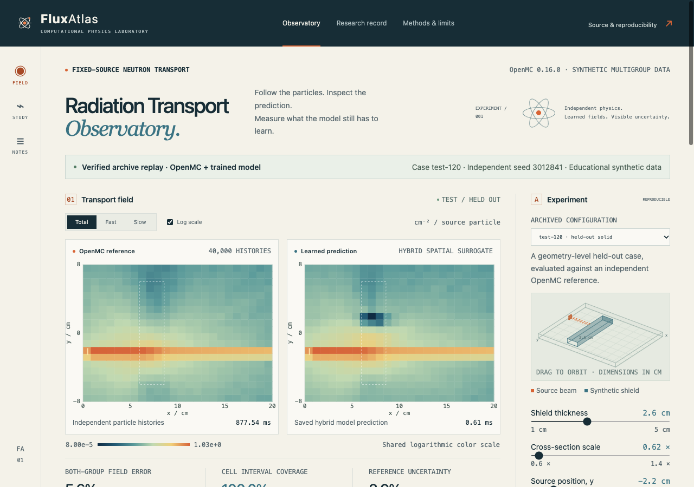
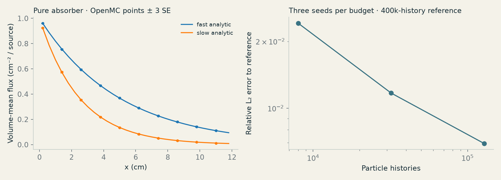
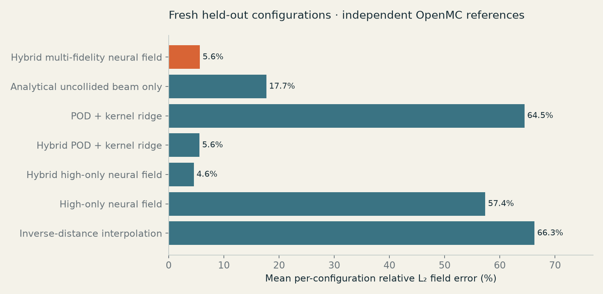
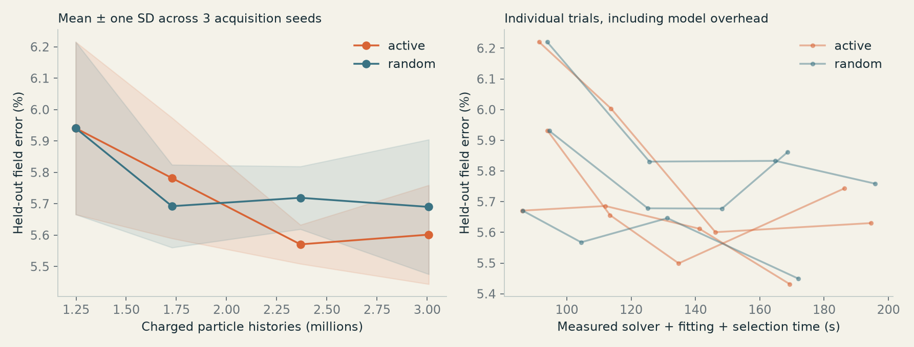
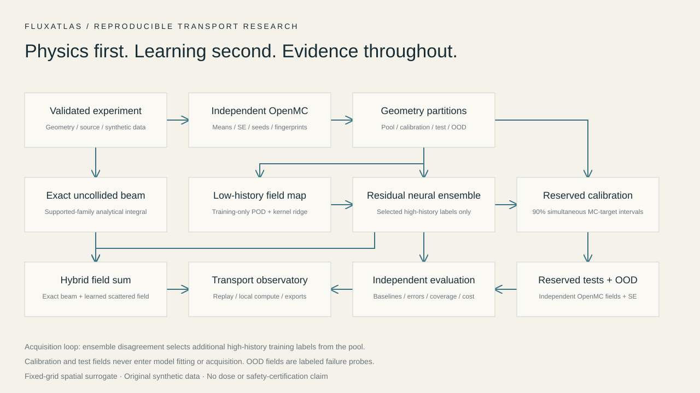

<p align="left"></p>

# FluxAtlas

**Compare particle-transport simulations with learned radiation fields.**

Inspect saved OpenMC results beside a trained spatial surrogate, including their errors and uncertainty. The educational shielding examples use synthetic materials; new transport calculations run in the local OpenMC environment.



[Capture provenance](media/observatory-current.md) · Retained independent reference, educational synthetic data; no new OpenMC execution.

[Open the observatory](https://nazeeh111.github.io/FLUXATLAS/) · [Technical report](docs/technical-report.md) · [Reproduce the experiments](docs/reproducibility.md) · [Research foundations](docs/research-foundations.md) · [Launch film](media/brag.mp4) · [Versioned release](https://github.com/nazeeh111/FLUXATLAS/releases/tag/v0.1.0)

This checkout is **0.1.1.dev0**, an unreleased product successor. The versioned
release link retains the original 0.1.0 downloads and scientific record. Model
weights, reference fields, calibration and study results retain their original
identities; the CLI reports the installed software generation separately.

## Explore without a solver

Inspect the saved archive in the [public observatory](https://nazeeh111.github.io/FLUXATLAS/),
or serve the same files from a complete checkout with Python alone:

```bash
git clone https://github.com/nazeeh111/FLUXATLAS.git
cd FLUXATLAS
python3 -m http.server 8765 --bind 127.0.0.1 --directory web
# Open http://127.0.0.1:8765
```

Archive replay displays retained results. Moving geometry controls previews a
configuration; the field maps remain attached to the prior computation until a
new model query or reference run succeeds. Static replay produces neither.
The plotted field is volume-mean scalar flux per source particle, not dose;
geometry uses synthetic materials.

## Query the retained weights and compare saved fields

A pip-only installation supports inference and comparison without OpenMC:

```bash
python3 -m pip install .
fluxatlas --version
fluxatlas predict --output my-prediction.npz
fluxatlas compare --prediction my-prediction.npz \
  --reference examples/reference/018aaf1e873bfacdc6f5/field.npz \
  --output comparison.json
fluxatlas serve
```

Run those commands from the complete checkout so the saved reference example is
available. The installed wheel bundles the observatory, model weights, primary
data arrays and Markdown methods; it does not place the repository's examples
or historical research directories in your working directory. From elsewhere,
pass the absolute path to an existing reference and keep its metadata.json
alongside it. Prediction uses the installed package's bundled numeric weights.

The observatory's **Export configuration** JSON can be passed directly to
`fluxatlas predict --config exported-configuration.json --output new-field.npz`.
The existing schema-1 envelope must contain its complete experiment configuration;
unknown versions and malformed envelopes are refused. Bare parameter objects
remain supported, including partial CLI configurations with documented defaults.
Only the experiment parameters become model inputs. Prior reference seeds,
history counts and provenance stay in the original JSON; importing them does not
replay an OpenMC run or authenticate a reference. The original file is untouched.

Open the exact URL printed by `serve`, normally http://127.0.0.1:8765. It opens no
browser automatically. `--port 0` selects an available port; Ctrl-C stops that
server. The interface distinguishes trained-model queries from OpenMC
availability, and disables unavailable computation controls. `/api/status` reports
the software version and loaded weight hash. Those hashes identify bytes; they
do not authenticate an artifact or identify every implementation dependency.

Prediction creates a numeric-only NPZ with complete configuration, fixed grid,
energy order, units, interval scope and the hash of the exact loaded weights.
Comparison checks those contracts against the saved field and adjacent metadata
before reporting errors and interval diagnostics. Neither command retrains a
model or executes a solver. Choose fresh output paths: existing predictions and
comparison files are refused. A single saved-field comparison is not a new
uncertainty-calibration study.

## New transport calculations and expert workflows

New independent references require the separate OpenMC executable and Python
module. The complete local laboratory environment remains:

```bash
micromamba create -f environment.yml
micromamba activate fluxatlas
pip install -e .
fluxatlas serve
```

Only an OpenMC-supported environment can run a new reference. The examples use
synthetic multigroup materials and need no external nuclear-data download.
Existing explicit commands remain available:

```bash
fluxatlas example --output my-reference --particles 1000
fluxatlas validate --output benchmarks/physics --cache .cache/fluxatlas
```

Generate, train and validation commands are expert study workflows, separate
from frozen-weight inference. Reproduction details and the original environment
are in [the reproducibility guide](docs/reproducibility.md). The recorded
0.1.0 release remains a historical generation rather than a package of these
new development changes.

## The scientific record

The final protocol uses a 96-configuration training pool, 24 fresh calibration configurations, 24 fresh in-domain tests and 12 held-out window geometries. High/low precision runs use independent seeds and 40,000/8,000 histories. A five-member optimized neural residual ensemble is compared against interpolation, POD/kernel regression, raw and hybrid high-only networks, the analytical beam and a low-fidelity ablation. Acquisition is repeated over three seeds at equal charged history budgets; separately recorded computational caps expose wall-time costs.

The technical report includes actual errors, calibrated interval coverage and width, runtime, energy-group results, convergence, baselines and failure cases. The initial direct-field model failed on the narrow moving beam; its genuine data and results are retained. A fresh final test design was generated after the hybrid revision. The release makes no general claim that neural models or active selection always win.







## Inside the laboratory

- **Independent transport:** validated geometry, original two-group macroscopic data, track-length mesh tallies, batch standard errors, exact seeds and source normalization.
- **Trained spatial surrogate:** analytical uncollided component, training-only POD basis, low-precision field map and bootstrapped neural corrections. Numeric-only model weights load without pickle.
- **Uncertainty study:** reserved-geometry 90% simultaneous field intervals against independent Monte Carlo estimates, plus explicit geometry-family OOD gates.
- **Observatory:** spatial/energy maps, paired reference/model fields, masked error/SE diagnostics, interval maps, interactive 3D geometry, acquisition sequences and CSV/JSON downloads.
- **Reproduction:** Python package/CLI/local API, original datasets, scripts, tests, CI, technical report, editable diagrams and an authentic product film.



## Scope and limits

The supported experiment is a fixed 24×20 mesh with one simplified non-fissioning shield family and a collimated two-energy neutron source. Lengths are cm; the displayed field is volume-mean scalar flux in **cm⁻² per source particle**. Synthetic coefficients do not represent concrete, lead, water or another real engineering material. Reflective z boundaries make this an educational extruded problem.

The model is a fixed-grid spatial surrogate, not a demonstrated resolution-independent neural operator. Intervals describe coverage of finite-history simulation estimates within the supported domain. Window geometry is a labeled failure probe. There is no dose or dose-rate output, physical measurement, CAD execution, continuous-energy validation, professional certification, or suitability claim for reactor operation, regulatory calculations or safety analysis.

## Source map

| Location | Purpose |
|---|---|
| `src/fluxatlas/transport.py` | Synthetic MG data and independent OpenMC adapter |
| `src/fluxatlas/ballistic.py` | Exact supported-family uncollided beam |
| `src/fluxatlas/model.py` | Neural/POD models, calibration, safe numeric weight export |
| `src/fluxatlas/study.py` | Fixed comparison and acquisition protocol |
| `data/` | Final split, fields, uncertainty, metadata and trained weights |
| `benchmarks/` | Actual physics/model results and exploratory failure archive |
| `web/` | Dependency-free observatory |
| `docs/` | Methods, reproducibility, limitations and generated figures |
| `media/` | Genuine screenshots, film and editable composition |

## License

Original code, synthetic data and branding use [MIT](LICENSE). See [dependency terms and data provenance](docs/licensing.md).
