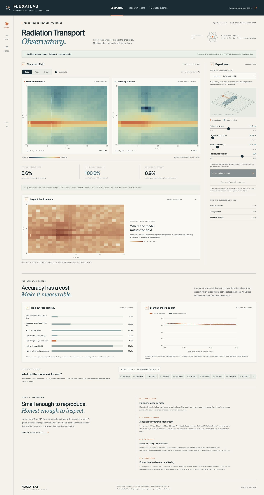
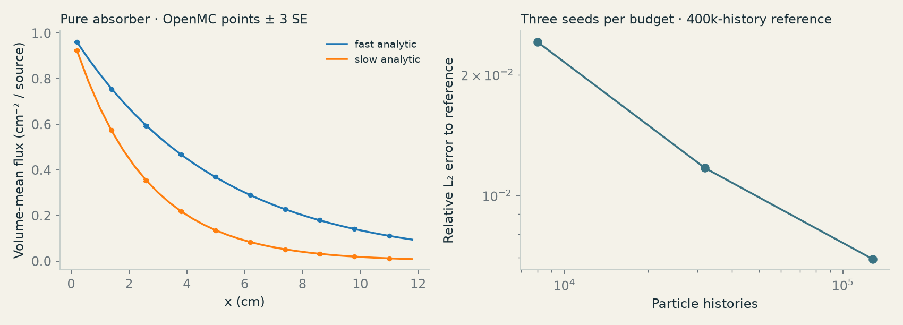
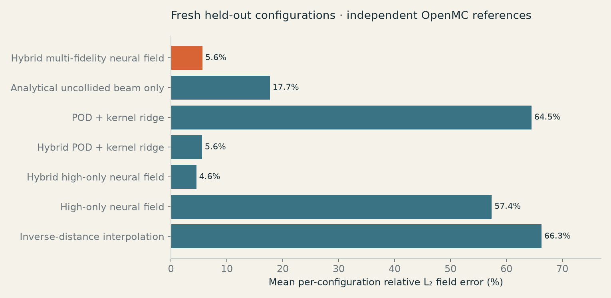
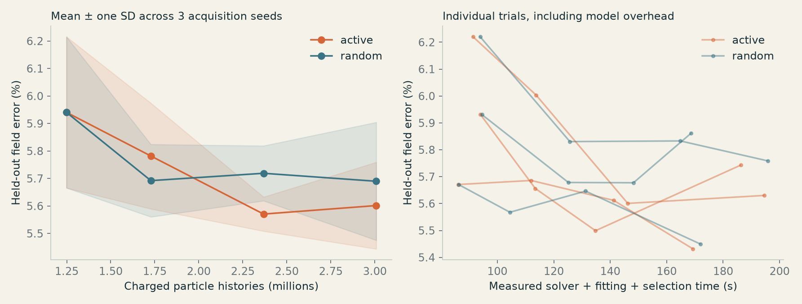
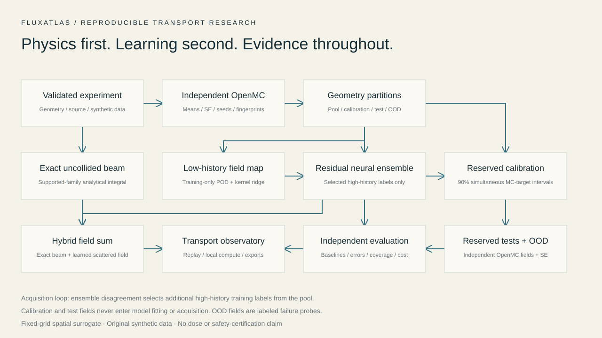

<p align="left"></p>

# FLUXATLAS

**An educational radiation transport observatory. Independent physics, learned fields, visible uncertainty.**

FLUXATLAS runs real OpenMC particle transport, trains a compact hybrid spatial surrogate, and makes their differences inspectable. It combines an exact uncollided beam with a genuinely trained multi-fidelity scattered-field model. All example materials are explicitly synthetic. Every reference, prediction, interval and benchmark has reproducible numerical provenance.



[Open the observatory](https://nazeeh111.github.io/FLUXATLAS/) · [Technical report](docs/technical-report.md) · [Reproduce the experiments](docs/reproducibility.md) · [Research foundations](docs/research-foundations.md) · [Launch film](media/brag.mp4) · [Versioned release](https://github.com/nazeeh111/FLUXATLAS/releases/tag/v0.1.0)

## Explore or compute

Replay the genuine saved experiment archive with Python alone:

```bash
python -m http.server 8765 --directory web
# Open http://localhost:8765
```

This is explicitly labeled archive replay. It does not launch a solver or pretend to compute new predictions. For the full local laboratory:

```bash
# Install micromamba or conda, then from this checkout:
micromamba create -f environment.yml
micromamba activate fluxatlas
pip install -e .
fluxatlas serve
# Open http://127.0.0.1:8765
```

The local interface can query the actual exported trained weights, execute new independently seeded OpenMC calculations, compare fields, and export numerical results. It binds to loopback and limits demonstration run size. OpenMC is available on conda-forge; if your platform cannot solve the environment, use an OpenMC-supported Linux/Mac environment. No external nuclear-data download is needed for the example.

```bash
fluxatlas example --output my-reference --particles 1000
fluxatlas predict --output my-prediction.npz
fluxatlas validate --output benchmarks/physics --cache .cache/fluxatlas
pytest -q
```

A pip-only install (`pip install .`) supports archived results and trained-model inference. Running a new solver requires the separate OpenMC executable and Python module, provided by the conda environment.

## The scientific record

The final protocol uses a 96-configuration training pool, 24 fresh calibration configurations, 24 fresh in-domain tests and 12 held-out window geometries. High/low precision runs use independent seeds and 40,000/8,000 histories. A five-member optimized neural residual ensemble is compared against interpolation, POD/kernel regression, raw and hybrid high-only networks, the analytical beam and a low-fidelity ablation. Acquisition is repeated over three seeds at equal charged history budgets; separately recorded computational caps expose wall-time costs.

The technical report includes actual errors, calibrated interval coverage and width, runtime, energy-group results, convergence, baselines and failure cases. The initial direct-field model failed on the narrow moving beam; its genuine data and results are retained. A fresh final test design was generated after the hybrid revision. The release makes no general claim that neural models or active selection always win.







## Inside the laboratory

- **Independent transport:** validated geometry, original two-group macroscopic data, track-length mesh tallies, batch standard errors, exact seeds and source normalization.
- **Trained spatial surrogate:** analytical uncollided component, training-only POD basis, low-precision field map and bootstrapped neural corrections. Numeric-only model weights load without pickle.
- **Uncertainty study:** reserved-geometry 90% simultaneous field intervals against independent Monte Carlo estimates, plus explicit geometry-family OOD gates.
- **Observatory:** spatial/energy maps, paired reference/model fields, masked error/SE diagnostics, interval maps, interactive 3D geometry, acquisition sequences and CSV/JSON downloads.
- **Reproduction:** Python package/CLI/local API, original datasets, scripts, tests, CI, technical report, editable diagrams and an authentic product film.



## Scope and limits

The supported experiment is a fixed 24×20 mesh with one simplified non-fissioning shield family and a collimated two-energy neutron source. Lengths are cm; the displayed field is volume-mean scalar flux in **cm⁻² per source particle**. Synthetic coefficients do not represent concrete, lead, water or another real engineering material. Reflective z boundaries make this an educational extruded problem.

The model is a fixed-grid spatial surrogate, not a demonstrated resolution-independent neural operator. Intervals describe coverage of finite-history simulation estimates within the supported domain. Window geometry is a labeled failure probe. There is no dose or dose-rate output, physical measurement, CAD execution, continuous-energy validation, professional certification, or suitability claim for reactor operation, regulatory calculations or safety analysis.

## Source map

| Location | Purpose |
|---|---|
| `src/fluxatlas/transport.py` | Synthetic MG data and independent OpenMC adapter |
| `src/fluxatlas/ballistic.py` | Exact supported-family uncollided beam |
| `src/fluxatlas/model.py` | Neural/POD models, calibration, safe numeric weight export |
| `src/fluxatlas/study.py` | Fixed comparison and acquisition protocol |
| `data/` | Final split, fields, uncertainty, metadata and trained weights |
| `benchmarks/` | Actual physics/model results and exploratory failure archive |
| `web/` | Dependency-free observatory |
| `docs/` | Methods, reproducibility, limitations and generated figures |
| `media/` | Genuine screenshots, film and editable composition |

## License

Original code, synthetic data and branding use [MIT](LICENSE). See [dependency terms and data provenance](docs/licensing.md).
