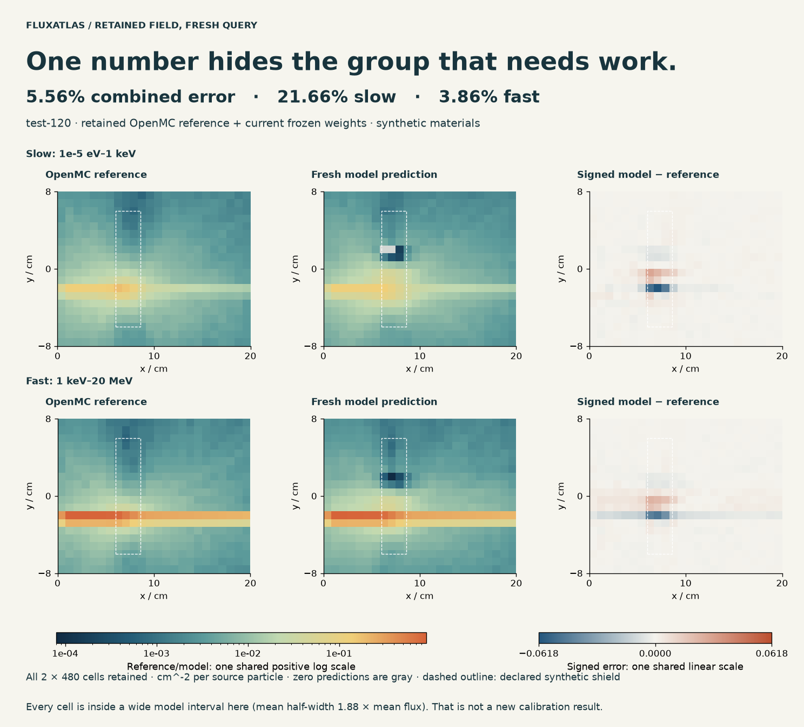

# One aggregate hides the slow-group error

FluxAtlas compares saved particle-transport fields with a trained fixed-grid surrogate. This completed current-source journey starts with the first observatory case, `test-120`, exports its actual configuration and 960 numerical rows, queries the frozen weights again, and compares that new prediction with the retained reference. No OpenMC calculation or training runs here.



[Phone vector](group-error-mobile.svg) · [Desktop vector](group-error.svg) · [Actual workbench](workbench.png) · [Phone workbench](workbench-mobile.png) · [Complete example](worked-example.zip)

## Follow one case through the product

The selected source is main `f69bfdc9e8bd12efaa49ab3cf35620afdcdffd45`, tree `debb5cb91c7ea0e65e57f97411e720391d9f1c2d`. Source remains the unreleased 0.1.1.dev0 generation. The separately held engineering branch is not merged into this presentation.

The browser opens `test-120`: 40,000 retained histories, seed 3012841, synthetic multigroup coefficients, a solid shield with thickness 2.5879317815422658 cm. The source is at y=−2.156731048555405 cm. The fixed mesh has 24×20 cells per energy group and 1 cm depth. These are **volume-mean scalar flux estimates, cm⁻² per source particle**, not dose or dose rate.

Actual actions exercised: select Slow by keyboard; inspect error/reference-SE; export numerical CSV, configuration JSON and research archive; rotate the declared geometry using an arrow key; preview a thickness change; restore the case and query the retained model. Previewing geometry leaves the prior fields and their exported bytes unchanged. A new model-only query correctly clears the old reference rather than pretending a new simulation happened. A controlled failed query and an actual invalid API request preserve the last valid model. The window-family archive explicitly warns that interval calibration does not apply.

The exported configuration is accepted directly by the source CLI. From a complete checkout with the normal Python dependencies available, choose fresh output paths:

```sh
PYTHONPATH=src python -m fluxatlas.cli predict \
  --config docs/presentation/configuration.json --output fresh-prediction.npz
PYTHONPATH=src python -m fluxatlas.cli compare \
  --prediction fresh-prediction.npz \
  --reference docs/presentation/reference/field.npz --output fresh-comparison.json
```

Prediction/repeated comparison outputs refuse existing paths. The browser and CLI query the same unchanged numeric weights. The recorded CLI arrays equal the saved prediction exactly in this runtime; the threaded API differs by at most floating-point roundoff, below 10⁻¹² absolute. Fresh records, archive exports and render bytes are not promised identical across runtime versions.

## What the comparison exposes

| Error against this retained reference | Relative L2 |
| --- | ---: |
| Both groups together | 5.56% |
| Slow, 10⁻⁵ eV to 1 keV | 21.66% |
| Fast, 1 keV to 20 MeV | 3.86% |

This first archived case illustrates why inspecting each energy group matters. It is not a newly selected benchmark or a general performance estimate. See the complete retained study in the [technical report](../technical-report.md).

All 960 cells are inside their saved model intervals in this example, but the mean interval half-width is about **1.88 times mean reference flux**. Coverage alone can conceal intervals too wide to be useful. The 90% simultaneous-field calibration target concerns finite-history simulation estimates in the supported family; it is neither a per-cell physical probability nor a guarantee for a new geometry.

The reference is a slice of existing `data/fields.npz` (`high`, index 120), with its exact original record from `data/reference-metadata.json`. These files are repackaged evidence, not a newly executed or independently measured reference. The source archive, dataset, metadata, weight and producing-code hashes are in [checks.json](checks.json). [comparison.json](comparison.json) records the native comparison contract and artifact hashes.

## Read every map honestly

The six panels retain every 480-cell array: slow/fast reference, fresh prediction and signed prediction-minus-reference. No interpolation, smoothing, fitted curve or subset selection is used. Reference and prediction share one positive logarithmic scale across both groups; all positive values are retained. The two zero predictions are explicit gray, not missing cells. Signed errors share one symmetric linear scale with zero at the center. Color units are cm⁻² per source particle. Dashed outlines show the declared synthetic shield, not inferred geometry or measured fabrication.

The [editable renderer](figure.py) and [figure manifest](figure-manifest.json) bind raw inputs, transforms, exact scale limits and exports. These are source-derived explanatory maps; the separate workbench capture is the real application. The actual UI's standard-error diagnostic is absolute error/SE; the explanatory signed panel deliberately shows the sign as additional information. Summed-group standard errors in the UI are conservative sums because covariance is unavailable; single-group views preserve their original SE.

## Reopen the evidence

Extract [worked-example.zip](worked-example.zip) into a fresh directory. Its manifest includes every named member, including original MIT notice, original case/configuration, actual CSV, prediction, reference, metadata and comparison. With NumPy installed, run `python reopen.py` to check hashes, reopen numeric-only NPZ and recompute the displayed ratios. This does not run the model or a transport solver. Fresh model inference uses the full pinned checkout and unchanged `data/model.npz`, explicitly external to the small data bundle.

The retained 0.1.0 release/studies, failed initial model and later fixed final test design remain separate in the main documentation. Synthetic materials, reflective depth boundaries and limited geometry remain educational. No physical shielding accuracy, safe design, dose, continuous-energy validation, neural-operator resolution independence or safety certification is established.
