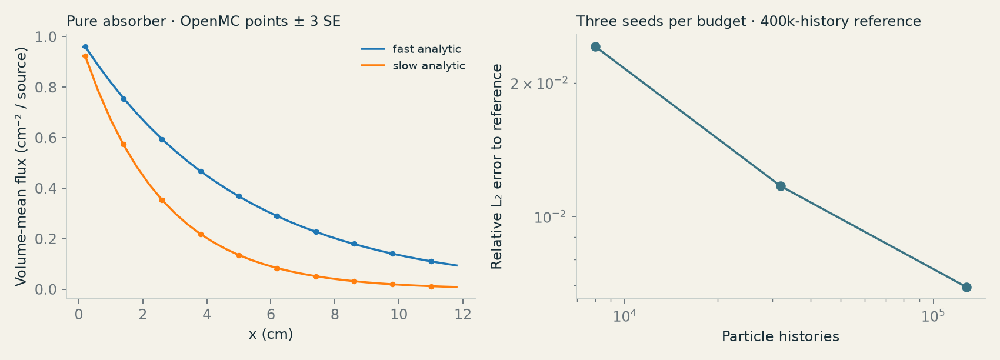
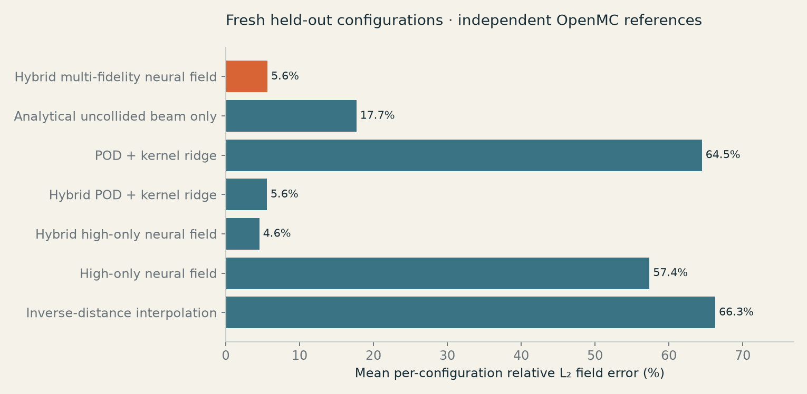
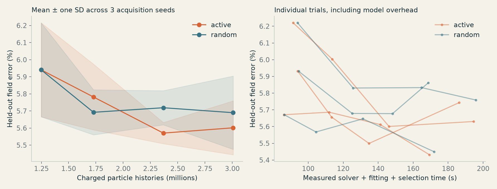

# FLUXATLAS technical report

Version 0.1.0 · Protocol 2 · Original educational computational experiment

## What ran

OpenMC 0.16.0 independently simulated a non-fissioning fixed-source neutron benchmark with original synthetic two-group cross sections. The released hybrid surrogate combines an exact uncollided-beam component with a genuinely trained POD neural residual ensemble for the scattered field. It is a fixed-grid spatial model, not a demonstrated resolution-independent neural operator. No physical measurements, real facility model, dose prediction or professional safety validation are claimed.

The final primary model's mean relative L₂ error is **5.65%** on 24 fresh held-out configurations. The best baseline in this experiment is **Hybrid high-only neural field** at **4.55%**. Read these results together; the hybrid neural component is not assumed to beat every conventional method.

## Experiment and units

Domain: x = 0–20 cm, y = −8–8 cm, z = −0.5–0.5 cm. Vacuum boundaries in x/y and reflective z boundaries make a thin extruded transport problem, not a realistic unrestricted 3D shield. Mesh: 24 × 20 × 1, cell volume 2/3 cm³. The shield occupies x = 6 to 6 + thickness and y = −6 to 6 cm. The source is uniform over y = source_y ±0.4 cm and z = ±0.49 cm at x = 0.5 cm, with monodirectional +x emission. It mixes 1 eV and 1 MeV neutrons.

Supported parameter box: thickness 1–5 cm, synthetic shield macroscopic cross-section scale 0.6–1.4, source_y −3–3 cm, fast fraction 0.6–1.0. OOD window shields remove |y| < 1 cm from the shield; these are excluded from training and calibration. The ballistic component deliberately assumes the supported solid shield, so the window family tests a real model limitation.

Energy edges in ascending tally order are [10⁻⁵, 10³, 2×10⁷] eV: slow then fast. OpenMC XSdata matrices use descending group order: fast then slow. Isotropic order-zero scattering, no fission, and synthetic macroscopic coefficients in cm⁻¹ are specified in `transport.py`. Background totals fast/slow: 0.025/0.04; fast→fast/slow scattering: 0.012/0.008; slow→slow: 0.025. Shield totals: 0.65/1.10; fast→fast/slow: 0.28/0.22; slow→slow: 0.65. Absorption is total minus row scattering sum. The shield scale multiplies all coefficients equally.

OpenMC track-length flux scores first have units cm per source particle. Dividing both mean and standard error by mesh-cell volume gives the volume-mean scalar-flux field in **cm⁻² per source particle**. Groups are energy-integrated, not per-eV densities. No source strength is assumed; flux-per-source must not be relabeled dose or dose rate. Batches provide an estimated standard error of each tally mean, not an exact confidence guarantee.

## Numerical verification

Pure homogeneous absorber runs use a collimated source and an exactly integrated exponential mesh average. Fast/slow relative L₂ errors are 0.240% / 0.263%, with zero wrong-group tally. The executable validation gate requires <2.5% field error, zero wrong-group tally and ≥80% of cells within three reported standard errors. This verifies the executed normalization and group mapping in the checked regime; exponential attenuation is not the full scattering solution.

The repeated-seed convergence study uses 8k, 32k and 128k histories with three independent seeds each against an independent 400k-history reference. Mean field errors are 2.415%, 1.170%, 0.694%. The anchor itself remains noisy. These validation runs are distinct from model training/test cases.

## Training and independence

There are 96 training-pool configurations, 24 reserved calibration configurations, 24 final in-domain test configurations and 12 held-out window geometries. Each high reference uses 40,000 histories in 20 batches. Each of 96 low-fidelity references uses 8,000 histories in 20 batches, independently seeded from its high reference. Here fidelity means statistical precision at fixed physics and mesh, not a different nuclear-data accuracy level.

The training pool uses Latin-hypercube seed 713. After the exploratory failure described below, final calibration/test/OOD settings were replaced with a predeclared fresh Latin-hypercube design (seed 271828) and fresh reference seeds. No final test geometry or label enters basis construction, optimization, calibration or acquisition. Hyperparameters were frozen before reading final results. The model is small enough to retrain locally with `fluxatlas train`.

The deterministic beam integrates attenuation across source and shield interfaces and transverse subcell source overlap. Subtracting it from low/high labels leaves a smoother scattered field, still carrying Monte Carlo noise. No logarithm of noisy training labels is taken. A training-only scale and 18-mode POD basis compress these fields. A low-fidelity RBF kernel-ridge map (gamma 1.5, alpha 0.04) predicts coefficients from normalized parameters. Five bootstrapped MLPs, each with 32/32 tanh units, learn high-fidelity residual coefficients using L-BFGS and L2 regularization alpha 0.15. A nonnegative reconstructed scattered field is added to the beam. Clipping, rank truncation, regularization, finite samples and noisy targets can introduce error. Neural optimization warnings are preserved in `study.json`; the primary fit reported 2 warning(s). Total primary training time was 137.400 s on this run.

Numeric-only NPZ exports store the actual optimized weights. A separate NumPy inference implementation is tested against the trained model. No executable pickle artifact is loaded.

## Held-out model comparison

| Model | Both-group L₂ | Slow-group L₂ | Fast-group L₂ |
|---|---:|---:|---:|
| Hybrid multi-fidelity neural field | 5.65% | 16.87% | 3.61% |
| Analytical uncollided beam only | 17.69% | 54.73% | 11.03% |
| POD + kernel ridge | 64.47% | 56.53% | 65.53% |
| Hybrid POD + kernel ridge | 5.56% | 16.41% | 3.58% |
| Hybrid high-only neural field | 4.55% | 13.26% | 2.88% |
| High-only neural field | 57.36% | 47.14% | 58.09% |
| Inverse-distance interpolation | 66.28% | 56.31% | 67.01% |

Errors are computed per configuration then averaged. Both-group L₂ weights energetic/high-flux cells strongly. `study.json` additionally records integrated-flux error, resolved-cell error (reference mean > 3 SE), per-case error and the fraction of errors beyond 1.96 reference SE. This last fraction is a diagnostic, not a statistical test of correct physics. It excludes neither model bias nor correlated-bin uncertainty.

For the hybrid model, mean reference relative L₂ standard error is 0.96%. Model error can substantially exceed Monte Carlo noise. Zero-count bins are not exact zero physical flux; the observatory masks error/SE ratios where SE is zero. Total-group SE uses a conservative sum of group SEs because cross-group covariance is not stored.

## Uncertainty calibration

The raw scale combines bootstrapped-ensemble spread with a declared magnitude floor: sqrt(spread² + (0.03×prediction + 0.002×case_peak)²). It is an acquisition/interval scale, not Bayesian posterior variance. Reserved calibration uses one maximum standardized absolute error over all 960 entries per geometry. For alpha=0.10 and n=24, the finite-sample conformal order statistic is ceil(25×0.90)=23. Its fitted scale multiplier is 16.063.

Final empirical simultaneous whole-field coverage is **100.0%** (24/24 fields). Marginal cell coverage is 100.00%; these are different quantities. Mean half-width divided by mean reference flux is 1.95, which exposes the cost of wide fieldwise intervals. The sample is small; no per-configuration conditional guarantee is established.

The calibration target is an independently simulated finite-history OpenMC estimate under the same in-domain sampling design. It does not establish coverage of exact physical truth, another source/mesh/material family, an evaluated continuous-energy result or an actual facility. OOD interval coverage is reported only as a failure diagnostic (33.3% whole-field); it is not calibrated. The OOD detector is an explicit family/bounds gate, with measured window detection 100.0% and in-domain false positives 0.0%. It is not learned discovery of arbitrary anomalies.

## Active learning and computational costs

The retrospective acquisition study uses three seeds with identical initial 12 high-history configurations for each active/random pair. Checkpoints contain 12, 24, 40 and 56 high-history labels. Both policies receive the same full low-history candidate pool, and all 96 × 8,000 low histories are charged at every checkpoint. Only selected high labels enter model fits. The selector never sees test references; they are used only to score fixed checkpoints. Active acquisition ranks candidate relative ensemble-scale norms and acquires batches of at most eight. This is a compact heuristic, not a claimed optimal information gain method. All high pool labels were precomputed for reproducible policy replay; the release reports that full dataset-generation cost separately.

At 56 high labels (3,008,000 charged histories):

| Strategy | Mean test L₂ | SD across acquisition seeds |
|---|---:|---:|
| active | 5.60% | 0.16 percentage points |
| random | 5.69% | 0.21 percentage points |

Three repeats support a small empirical comparison, not universal superiority or a precise significance claim. `active_learning` rows contain acquisition identifiers, per-case test errors, solver costs and cumulative fitting/selection/evaluation overhead. Mean test predictions take 0.934 ms per case in a 24-case batch, compared with mean reference setup+execution+extraction time 1.592 s. A single interactive query has different overhead. These are local measured times on shared Apple-arm64 resources, not a controlled hardware performance claim; simulation startup/import, current load and numerical libraries affect timing. No reference simulation is required for model inference. Training, low-pool generation and acquisition costs must be paid before inference savings can accumulate.

To compare under equal measured computational caps as well as equal histories, each repetition uses a shared cap that both policies can afford, then selects its last completed checkpoint within that cap. Unused budget is explicit; this is retrospective checkpoint accounting, not a live equal-time scheduler. Charged cost includes measured low+selected-high solver wall time and cumulative model overhead. Cross-run load affects these costs.

| Repeat | Policy | Equal cap (s) | Charged (s) | High labels | Test L₂ |
|---|---|---:|---:|---:|---:|
| 1 | active | 194.56 | 194.56 | 56 | 5.63% |
| 1 | random | 194.56 | 164.83 | 40 | 5.83% |
| 2 | active | 168.67 | 134.79 | 40 | 5.50% |
| 2 | random | 168.67 | 168.67 | 56 | 5.86% |
| 3 | active | 169.33 | 169.33 | 56 | 5.43% |
| 3 | random | 169.33 | 131.27 | 40 | 5.65% |

Full final dataset generation includes 6,240,000 high and 768,000 low histories, including validation/test references needed for the research evaluation. Analytical and convergence runs are additional. The separately preserved exploratory dataset also has its own real cost; it is not part of the final policy's selected-label budget.

## Failure case and research iteration

The initial direct full-field POD neural model had **64.56%** mean field error on the exploratory test set; the narrow moving beam was poorly represented by that small model. Its weights, design, fields, source snapshots and metrics remain in `benchmarks/exploratory-v1/`. Those inspected tests were not reused as final evaluation. The revision adds known uncollided physics, learns only the smoother scattered field, and uses fresh calibration/test/OOD configurations. This is an observed engineering/research improvement, not a pre-registered single-attempt success. The original source snapshots predate `hybrid` and contain all required v1 model code; they are reference records, not installed modules.

Other limits include a fixed 24×20 mesh, one non-fissioning synthetic material family, a thin reflective-z experiment, a small training set, limited geometry variation, no CAD/DAGMC execution, no continuous-energy validation and no physical dose-rate conversion. Better interpolation or reduced-order methods may outperform the neural model. The interface preserves individual failure cases instead of showing only favorable maps.

## Reproduction and extension

Follow `docs/reproducibility.md`. `data/design.json`, `data/reference-metadata.json`, `data/fields.npz`, `data/model.npz`, `benchmarks/study.json` and `benchmarks/physics/validation.json` are the numerical record. `web/atlas.json` derives from those fields and weights. Cached runs include source/config+solver fingerprints so changing physics cannot silently reuse stale bytes. Cross-platform Monte Carlo reductions and math libraries may differ slightly; validate tolerances and report hardware.

For continuous energy, obtain a separately licensed, suitable evaluated nuclear library and configure OpenMC explicitly, then implement and revalidate a separate adapter. No continuous-energy results are included. DAGMC is an optional future extension, not a supported UI capability. Method foundations, recent related literature and the PaperVizAgent decision are linked in [research-foundations.md](research-foundations.md); licenses are in [licensing.md](licensing.md). Editable conceptual architecture: [SVG](architecture.svg) and [Mermaid](architecture.mmd). Numerical figure generation is `scripts/build-report.py`.
